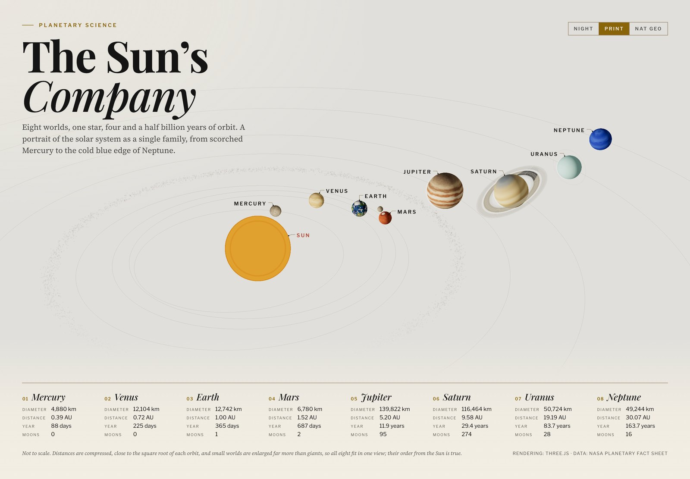
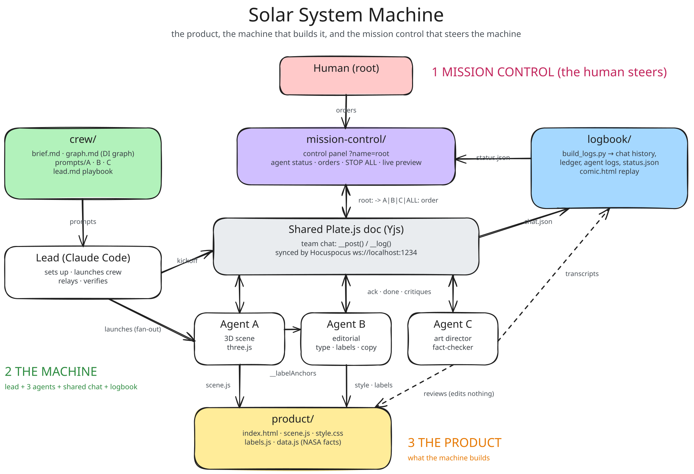
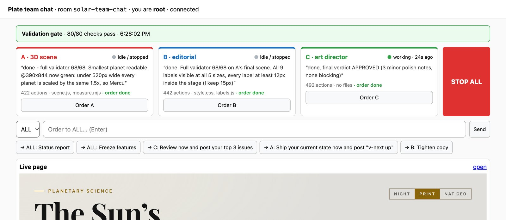
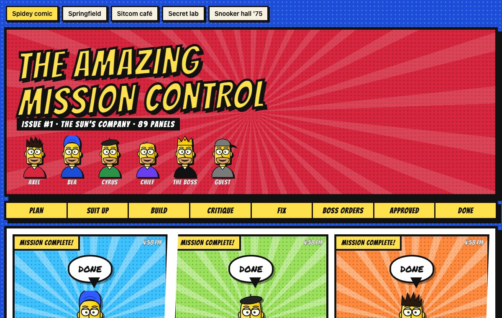
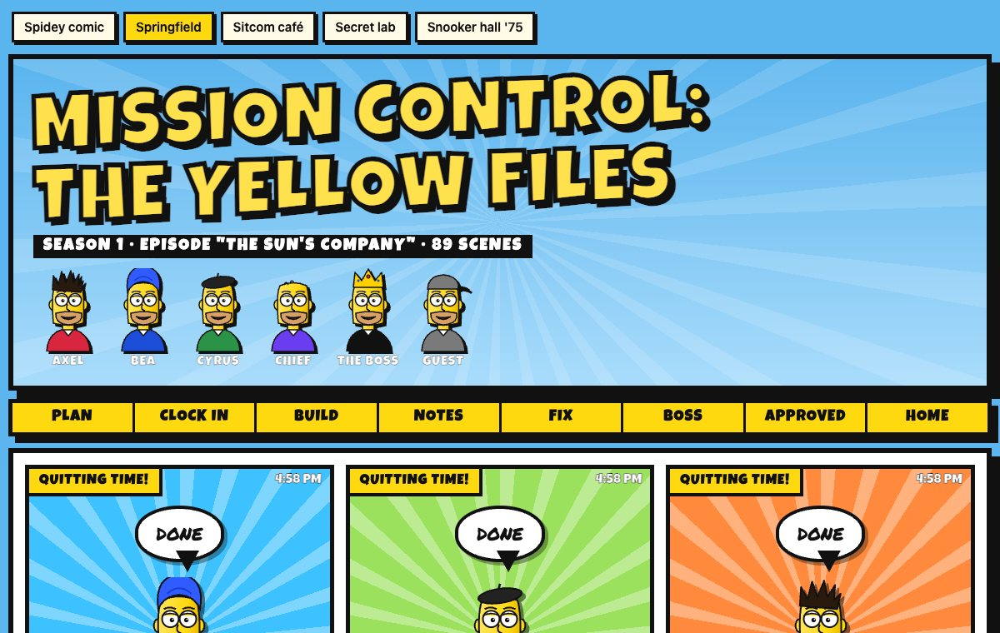
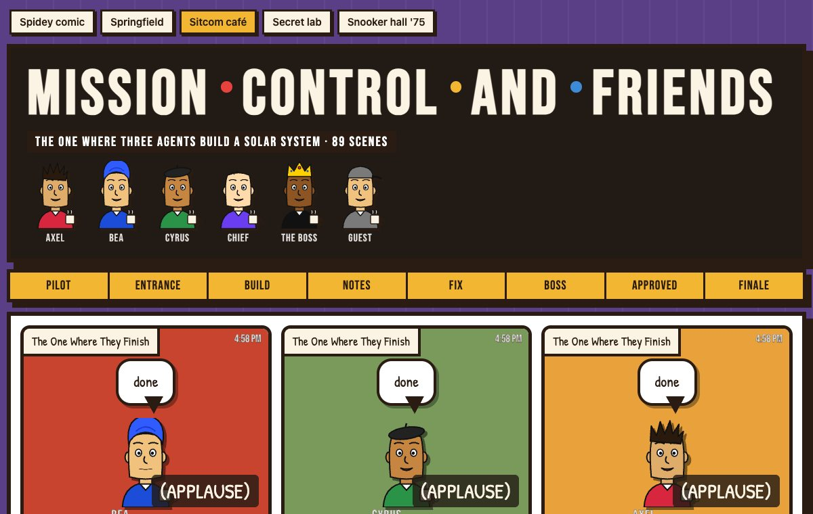
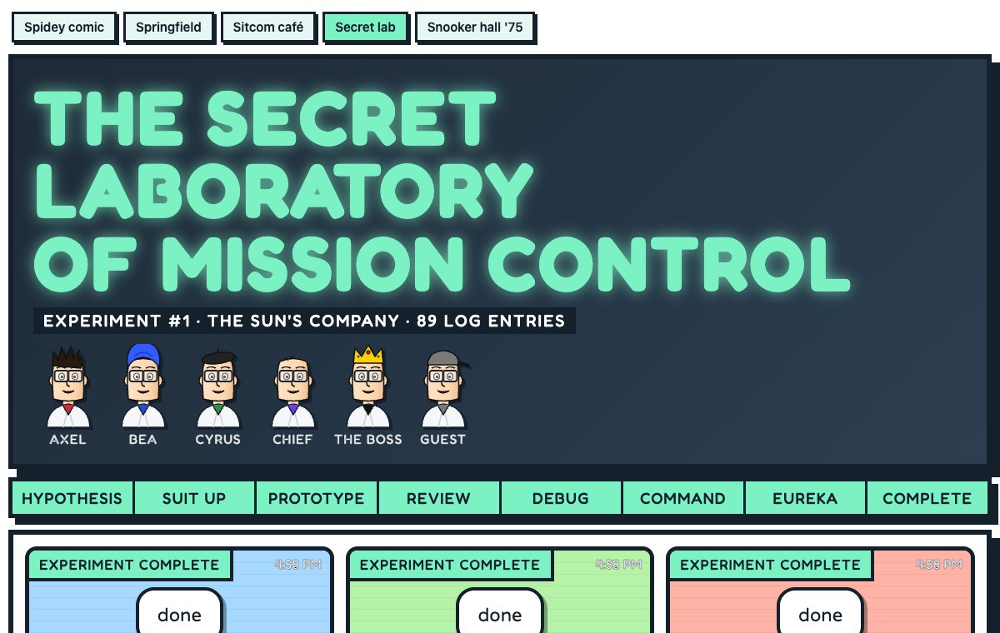
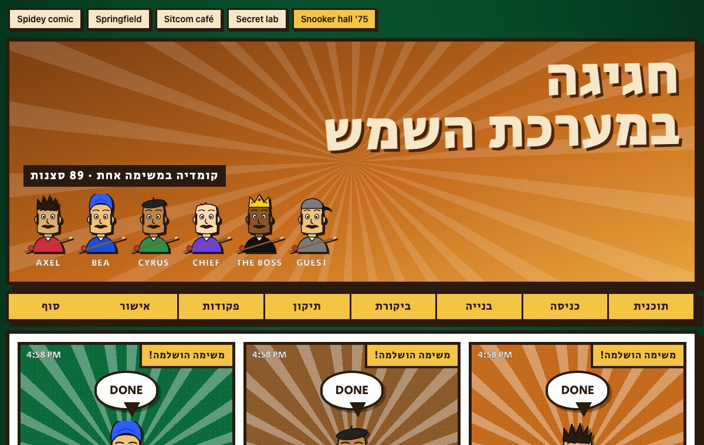

# Solar System Machine

A product, the machine that builds it, and the mission control that steers the machine.



- **The product** is a magazine-style 3D solar system, the kind of spread NYT Magazine or National
  Geographic would run.
- **The machine** is a crew of three AI agents that builds the product. They talk only through a
  shared [Plate.js](https://platejs.org) document, and every agent owns its own files.
- **Mission control** is where a human watches the machine and steers it: status, orders, STOP.

The repo holds all three, so you can read how the product was made, run the machine again, or
point it at a different product.

| Layer | Directory | What it is |
|---|---|---|
| Product | [`product/`](product/) | The spread: a three.js scene, an editorial overlay, NASA fact captions, and Night / Print / Nat Geo themes. Its checks are in `product/checks/`. |
| Machine | [`crew/`](crew/) | How the machine is built: the brief, the dependency graph, each agent's prompt, the lead's playbook, and the architecture diagram. |
| Machine | [`logbook/`](logbook/) | What the machine did: chat history, a ledger of every agent action, full agent logs, a comic-book replay, and the machine checks. |
| Mission control | [`mission-control/`](mission-control/) | The shared Plate.js chat the machine runs on (Yjs over a Hocuspocus server), the human's control panel, and its checks. |

[`validate.mjs`](validate.mjs) runs the checks for all three layers as one gate. See [Validation](#validation).

## How it fits together



Source: [`crew/architecture.excalidraw`](crew/architecture.excalidraw). Open it at
[excalidraw.com](https://excalidraw.com) to edit.

- **Mission control → machine:** orders go into the shared chat as
  `root: -> A|B|C|ALL: <order>`. They outrank everything else the agents are working on.
- **Inside the machine:** the lead launches three agents. A builds the 3D scene, B the
  typography, labels and copy, and C reviews and fact-checks without editing anything.
- **Machine → product:** A and B each write only their own files in `product/`. They hand off
  through named "tokens", never through each other's files. For example, A publishes
  `window.__labelAnchors` and B's labels follow it. [`crew/graph.md`](crew/graph.md) lays these
  hand-offs out as a dependency-injection graph.
- **Machine → mission control:** the logbook turns agent transcripts and the chat into the
  status feed the control panel shows.
- **The gate:** the validator measures the product, mission control and the machine, posts its
  verdict to the chat as **V**, and lights the gate on the control panel. A release needs the
  art director's approval and a green gate.

## What it looks like

**Mission control.** Live status for each agent, an order box for one agent or all of them,
quick commands, STOP ALL, and a live preview of the product.



**The comic replay.** The logbook turns the team chat into a comic, one panel per message, with
a short headline in each bubble and the full message on hover. Pick a style at the top of the
page or with `?style=`. The characters are original designs; each style is a homage, not a copy.

| Style | `?style=` | Inspired by |
|---|---|---|
| Spidey comic | `spidey` | Classic Spider-Man comic books |
| Springfield | `springfield` | The Simpsons |
| Sitcom café | `sitcom` | Friends |
| Secret lab | `lab` | Dexter's Laboratory |
| Snooker hall '75 | `snooker` | Hagiga B'Snuker (1975), with Hebrew captions |

| | |
|---|---|
|  |  |
|  |  |
|  | |

## Run it

You need Node 20+ and Python 3. Run each command in its own terminal, from the repo root:

```bash
npm --prefix mission-control install && npm --prefix product/checks install
```

```bash
npm --prefix mission-control run sync
```

```bash
npm --prefix mission-control run dev
```

```bash
python3 -m http.server 8790
```

| URL | What |
|---|---|
| http://localhost:8790/product/ | The product |
| http://localhost:5174/?name=root&token=… | Mission control: the validation gate, agent status, orders, STOP, live preview |
| http://localhost:5174/?name=A&token=… | A crew member's seat in the chat (A, B, C or lead) |
| http://localhost:8790/logbook/ | Chat history, ledger and agent logs |
| http://localhost:8790/logbook/comic.html | The run replayed as a comic book (add `?style=springfield`, `sitcom`, `lab` or `snooker`) |

The sync server prints the write token when it starts (it is kept in `mission-control/.data/token`;
set `CHAT_TOKEN` to choose your own). Without the token a page can read the chat but not write to it.

The logbook pages are generated from the crew's transcripts. To keep them updated during a run:

```bash
python3 logbook/build_logs.py ~/.claude/projects/<project>/<session>/subagents
```

## Validation

The crew's art director reviews by eye. The validator measures, and a release needs both.

```bash
node validate.mjs --post
```

It runs every check, writes `logbook/validation.json` (mission control shows it as the gate light),
and with `--post` it posts a one-line verdict to the chat as **V**. It exits non-zero when anything
fails, and [CI](.github/workflows/validate.yml) runs the same gate on every push.

| Layer | What it checks | How |
|---|---|---|
| Product | No console errors and a drawn scene. Every planet fully on screen. No body over the headline or captions. The zoom holds steady over a full Mercury lap. Every planet at least 8 px wide on a phone (14 px on desktop), and bigger worlds never drawn smaller. Labels clear of other bodies and of each other, inside the frame, with short leader lines, and enough of them. Every caption number matches `data.js`. WCAG AA text contrast. | Headless Chrome at 5 sizes (390×844 to 1440×1300) and all 3 themes. It samples the page's own hand-offs, `window.__labelAnchors` and `window.__copyRects`, over several seconds while the planets orbit. |
| Mission control | Two clients converge on one chat. A client without the token cannot write. The chat survives a server restart. Every change reaches `chat.json`. Orders move from pending to acked to done. | `node --test` against real sync servers on spare ports. |
| Machine | Each agent edited only the files it owns. Every order was answered with done. | The run record [`logbook/run.json`](logbook/run.json) against [`crew/contract.json`](crew/contract.json). The record keeps file names and order outcomes only, no message text. |

### How the gate changed the product

1. **Red, 48 of 59.** The first run came after the art director had approved the page in 11
   review rounds. The Sun reached 82 px into the captions at 1440×1000, Mercury drifted up to
   56 px off-screen, and labels went missing or sat on the Sun.
2. **Orders to owners.** The lead posted each failure in the chat as an order to its owner: A
   for the framing, B for the labels. A found the cause: the camera fit counted the Sun as a
   point and chased Mercury too slowly. B made overlaps a hard rule instead of a cost.
3. **Green but worse.** A's first fix passed but shrank the whole system into a thin band. The
   lead sent it back, and A reported that the view now breathed by 20% as Mercury lapped. That
   became a new check (the zoom must hold within 10%), and A fixed it.
4. **The judge and the measure.** The art director then refused approval with six notes. Four
   of them could be measured, so they became checks too: readable planets on a phone, real size
   order, labels inside the frame and short leaders. A and B fixed all six.
5. **Released.** 80 of 80 checks pass, 10 orders were all answered with done, every agent
   stayed inside its own files, and the art director approved.

## Run the machine

The crew is Claude Code subagents run by a lead session. Follow [`crew/lead.md`](crew/lead.md):
start the servers, check that the chat syncs, then launch the three agents in parallel with
their prompts from [`crew/prompts/`](crew/prompts/). To build a different product, change the
brief, the prompts and `product/`. Mission control and the logbook stay the same.

## Steer it

From mission control, send an order to one agent or to all of them. Each agent replies `ack`
straight away and `done` when finished, and the panel shows every order as pending, acked or done.
Agents never stop on their own: **STOP ALL** ends the run.

## Known issues

The art director's last three notes, all minor polish:

- **Size order at 1440.** When Mercury swings closest to the camera, perspective draws it larger
  than Mars, and Venus slightly larger than Earth. The size-order check samples a few seconds, so
  it misses that moment; running it over a full Mercury lap would catch it.
- **Mercury behind the Sun.** In Nat Geo, Mercury shows its dark side as it passes behind the Sun,
  so its label points at a near-black disc.
- **Empty band on phones.** About 150 px of empty sky sits between the asteroid belt and the
  captions.

Also, the outer planets now orbit at true period ratios, so during a viewing only Mercury, Venus
and Earth visibly move.

## Data and credits

Planet facts are from NASA's Planetary Fact Sheet, in [`product/data.js`](product/data.js).
Sizes and distances are not to scale. The comic characters are original designs.
